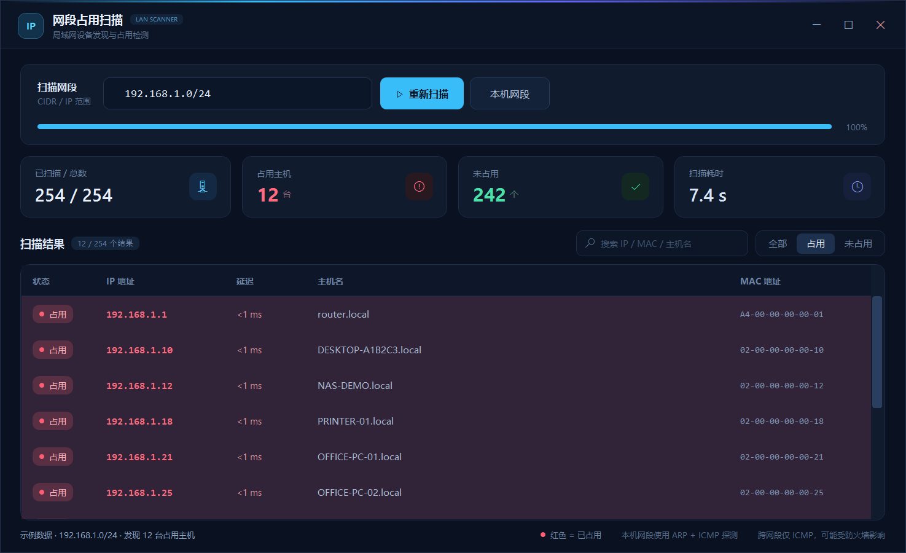

# 局域网 IP 扫描工具

一个 Windows 桌面小工具，用来快速查看某个 IPv4 网段里哪些地址正在使用。扫描结果会在表格中将**占用地址整行标红**，并显示延迟、主机名和 MAC 地址。

> 预览图使用示例数据（192.168.1.x / `02-00-...` 虚拟 MAC），不代表真实网络环境；实际扫描结果只保存在本机。

## 启动

双击 **`启动网段扫描.bat`**。

- 工具会自动查找 PowerShell 7（`pwsh`），找不到时使用 Windows 自带的 Windows PowerShell 5.1。
- 不需要管理员权限，不会安装任何服务或驱动。
- 如果系统提示脚本执行策略/安全警告，请允许运行；启动器已经使用 `-ExecutionPolicy Bypass`。

## 使用方法

1. 在“扫描网段”输入框中填写目标，例如 `192.168.1.0/24`。
2. 点击“开始扫描”，或直接按回车。
3. 扫描完成后：
   - 红色整行 = 该 IP 已被占用；
   - 顶部统计卡显示占用 / 未占用数量与耗时；
   - 点击“占用”只看被占用的地址；
   - 在搜索框按 IP、MAC 或主机名过滤；
   - “本机网段”会列出当前电脑所在的网段供选择。

## 支持的输入格式

| 格式 | 示例 | 说明 |
|---|---|---|
| CIDR | `192.168.1.0/24` | 自动排除网络地址和广播地址 |
| 简写范围 | `192.168.1.1-254` | 扫描 .1 到 .254 |
| 完整范围 | `192.168.1.10-192.168.1.60` | 起始/结束地址都写全 |
| 单个地址 | `192.168.1.88` | 只扫描一台 |
| 通配 | `192.168.1.*` | 等价于 .1-.254 |
| 多个目标 | `192.168.1.0/24,10.0.0.1-20` | 用逗号分隔 |

单次最多扫描 **4096** 个地址；默认并发 128 路、ICMP 超时 800 ms，扫描期间可以点“停止”。

## 判定方式

- **本机所在网段**：优先使用 ARP 探测（`SendARP`），能发现屏蔽了 ICMP 但仍在线的设备，并直接取得 MAC 地址；ARP 无响应时再用 ICMP 兜底。
- **跨网段**：使用 ICMP Echo（Ping）探测。
- **主机名**：对在线地址做反向 DNS 查询，最多等待 280 ms，查不到显示 `—`。
- 因此跨网段扫描时，如果目标主机或防火墙禁用了 ICMP，可能被误判为“未占用”；本机网段用 ARP，结果更准确。

## 文件说明

| 文件 | 作用 |
|---|---|
| `启动网段扫描.bat` | 双击启动器 |
| `LanScanner.ps1` | 主程序（WPF 界面 + 扫描引擎） |
| `preview.png` | 界面预览图 |

## 常见问题

**为什么扫描一个 /24 要几秒？**
本机网段的 ARP 探测需要等待未响应地址的 ARP 超时；这是为了发现“禁 Ping 但确实在线”的设备。跨网段纯 Ping 通常会更快。

**为什么 MAC 显示 `—`？**
MAC 只能通过本机网段的 ARP 获取。跨网段、或设备与电脑之间有三层路由时，拿不到 MAC 是正常的。

**端口/服务也能扫吗？**
当前版本只做主机在线（占用）探测，不做端口扫描。
